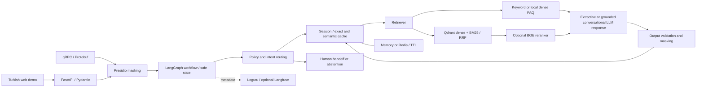

# TelcoAI · Privacy-aware telecom support agent

Türkçe telekom müşteri desteği için geliştirilen portföy projesi. Kurgusal DemoTel ana sayfasına gömülü, ikonla açılan sohbet paneli ve 40 sentetik destek kaydı içerir. DemoTel adlı kurgusal operatörün SSS verisini kullanır; fatura, paket ve teknik destek sorularını kaynak göstererek yanıtlar, kişisel bilgi örüntülerini maskeler ve hesap işlemlerini insan desteğine yönlendirir. Amaç; kurumsal yapay zekâ geliştirme becerilerini çalışan kod, ölçülebilir değerlendirme ve açık mimari kararlarla göstermek.

**Hızlı başlangıç:** Python 3.12 veya 3.13 ve [uv](https://docs.astral.sh/uv/getting-started/installation/) kurun, ardından `uv sync --frozen --extra dev` ve `uv run --frozen --no-sync uvicorn app.main:app --reload` çalıştırın. [Arayüz](http://127.0.0.1:8000), [OpenAPI](http://127.0.0.1:8000/docs). Varsayılan demo API anahtarı veya model indirmesi gerektirmez. Qdrant ve Redis için aşağıdaki enterprise profilini kullanın.

This project demonstrates a Turkish telecom support workflow with a practical upgrade path from a local demo to a containerized service. It uses **synthetic FAQ data**. It is an independent portfolio project, with no affiliation with Etiya or any telecom operator. “Enterprise” names the integration profile; it does not imply production certification.

The demo website now presents DemoTel as a fictional consumer telecom brand. Open the floating support icon to try the assistant; the chat-only panel offers a TR/EN selector above the conversation. Each language keeps its own session, FAQ answer, source citation and cache entry. The expanded [conversation guide](docs/conversation-design.md) explains the synthetic corpus, research references, support journeys and boundaries.

## Website and chat preview

The main page is a fictional telecom company website in [`static/index.html`](static/index.html). The assistant opens from the floating icon at the lower-right corner. Its compact panel is anchored near the bottom edge and contains only the conversation, with a Turkish/English selector in the header. Switching to **ENG 🇺🇸** starts the English conversation; **TR 🇹🇷** starts the Turkish conversation. Each language has its own session.

The chat supports multiple turns. After each answer it offers three topic-aware quick replies that send the next question immediately. Visitors can also type any follow-up, choose **Ask another question**, start a fresh chat, or end the chat while keeping the session history available.

For a complete preview with working RAG responses, start the FastAPI app and open **http://127.0.0.1:8000/**. The interface uses same-origin static assets and API requests, so run it through FastAPI instead of opening the HTML file directly.

The project includes focused tests for greeting/thanks, retrieval, source grounding, privacy masking and human handoff. See [verification evidence and limits](docs/verification.md) for the last full-suite run and its environment constraints.

## What a reviewer can try

1. Ask “Bu ay faturam neden daha fazla geldi?” and inspect the cited FAQ.
2. Include a synthetic e-mail or phone number and inspect the redaction indicator.
3. Ask for an account cancellation and inspect the human handoff decision.
4. Ask an unrelated question and inspect the abstention/fallback behavior.
5. Continue a session, inspect its redacted history, then delete it.
6. Open the DemoTel homepage at `http://127.0.0.1:8000/`, open the lower-right assistant, say “Selam”, then select a suggested next question or type a follow-up. Try ending the chat and opening it again.
7. Run the retrieval benchmark and inspect individual failures instead of relying on a headline score.

## Stack and implementation

| Capability | Implementation | Activation |
| --- | --- | --- |
| HTTP API and contracts | FastAPI, Pydantic request/response models, OpenAPI | Default |
| Stateful workflow | LangGraph with typed state, routing, cache, retrieval and response validation | Default |
| Privacy masking | Microsoft Presidio recognizers/anonymizer for e-mail, Turkish mobile phone, ID-like numbers, IBAN and card-like numbers | Default; pattern-based, limited coverage |
| Guardrails | Local input policies and output/schema validation; optional Guardrails AI adapter | Built-in checks default; optional extra |
| Retrieval baseline | Turkish and English keyword matching against bilingual local JSON FAQ | Default, offline |
| Dense retrieval | SentenceTransformers multilingual embeddings, in-memory cosine search | `semantic` extra and strategy |
| Hybrid retrieval | Qdrant named dense and BM25 sparse vectors, RRF fusion, indexed tenant/locale/category filters | Enterprise profile |
| Re-ranking | Optional multilingual `BAAI/bge-reranker-v2-m3` cross-encoder | Enterprise profile + configuration |
| Session history and caching | TTL-bound memory/Redis storage, exact response cache, optional bounded semantic cache | Memory default; Redis enterprise |
| Service interface | Protobuf/gRPC adapter over the same support workflow | `grpc` Compose profile |
| Observability | Loguru queued structured logging, optional Langfuse tracing | Logging default; Langfuse opt-in |
| Evaluation | Hit@1/3, MRR, OOD false acceptance, latency p50/p95; MLflow tracking and Ragas judge adapter | Offline retrieval/export default; judge opt-in |
| Delivery | uv lockfile, Ruff, pytest, GitHub Actions, non-root Docker, Compose, Kubernetes examples | Included |

The app is a RAG chatbot: it retrieves FAQ evidence, then either returns the source answer or asks an optional LLM to write a natural reply in the selected language grounded in that evidence. The LLM receives the latest redacted conversation turns and must return a Pydantic-validated source ID with its answer; unknown sources or provider errors fall back to the localized retrieved FAQ. A source citation proves provenance, but does not prove every generated sentence is factually correct, so review LLM replies before production use. Greetings and thanks receive conversational responses without querying the FAQ.

## Architecture



Tenant and locale come from server configuration. HTTP clients can narrow a query by category. Qdrant applies those scopes to both prefetch branches and the fused query. API startup is read-only: ingestion is an explicit command, and repeating it upserts deterministic point IDs without recreating collections or deleting another tenant’s data.

LangGraph is the selected orchestration framework. CrewAI and AutoGen are alternative choices for a different agent-coordination design; the implemented support flow uses explicit LangGraph state transitions.

Read [architecture and decisions](docs/architecture.md), [privacy boundaries](docs/privacy.md), [evaluation methodology](docs/evaluation.md), and [deployment](docs/deployment.md) for details.

## Run locally

```bash
uv sync --frozen --extra dev
uv run --frozen --no-sync uvicorn app.main:app --reload --host 127.0.0.1 --port 8000
```

The app responds conversationally to greetings in the default mode. To enable generated, context-aware answers, configure a running OpenAI-compatible local or remote model endpoint, set `TELCOAI_GENERATION_BACKEND=llm` in `.env`, then restart the server. The starter `.env.example` points to Ollama at `http://localhost:11434/v1` with model `qwen3:8b`; the model server and weights are installed separately. If the endpoint is unavailable, the assistant returns the retrieved FAQ answer.

To enable dense semantic retrieval locally, install its optional models and set `TELCOAI_RETRIEVAL_STRATEGY=semantic` in `.env`. For combined dense and BM25 sparse retrieval, use `TELCOAI_RETRIEVAL_STRATEGY=qdrant_hybrid` with the enterprise Compose profile and ingest the FAQ collection as described in [deployment](docs/deployment.md). Semantic and hybrid modes download model assets on first use.

Supported Python: **3.12–3.13**. Dependencies are pinned in `uv.lock`; optional extras keep model downloads and paid evaluation out of the default demo. Configuration is validated from `TELCOAI_*` environment variables and an optional local `.env`; use [.env.example](.env.example) as a starting point.

```bash
curl -s http://127.0.0.1:8000/health
curl -s http://127.0.0.1:8000/ready
curl -s http://127.0.0.1:8000/api/v1/chat \
  -H 'Content-Type: application/json' \
  -d '{"message":"Fatura ödeme kanallarınız neler?"}'
```

`GET /health` is liveness. `GET /ready` checks the configured storage/retrieval dependencies and can return `503`. `GET /api/v1/status` describes active runtime features for the demo interface. OpenAPI documents the full chat and session contract.

Dense mode downloads a multilingual embedding model on first use:

```bash
uv sync --frozen --extra dev --extra semantic
TELCOAI_RETRIEVAL_STRATEGY=semantic \
  uv run --frozen --no-sync uvicorn app.main:app --reload
```

## Docker and the enterprise integration profile

Default demo:

```bash
docker compose up --build -d api
```

Qdrant + Redis + hybrid retrieval:

```bash
# Start databases before the explicit ingestion step.
docker compose -f compose.yaml -f compose.enterprise.yaml --profile enterprise up -d qdrant redis
# Build the image with semantic model dependencies.
docker compose -f compose.yaml -f compose.enterprise.yaml --profile enterprise build api
# First run downloads embedding/BM25 assets into a persistent model cache.
docker compose -f compose.yaml -f compose.enterprise.yaml --profile enterprise run --rm --no-deps api python scripts/ingest.py
# Start the HTTP service after ingestion succeeds.
docker compose -f compose.yaml -f compose.enterprise.yaml --profile enterprise up -d api
```

The API remains at `127.0.0.1:8000`. Database ports are bound to loopback for local inspection. Persistent volumes retain Qdrant data, Redis AOF and downloaded model assets. See [deployment](docs/deployment.md) for gRPC, Kubernetes, configuration and dependency failure behavior. `make enterprise-db`, `make enterprise-ingest`, and `make enterprise` wrap these commands.

Optional re-ranking adds a model download and latency:

```bash
TELCOAI_RETRIEVAL_STRATEGY=qdrant_hybrid TELCOAI_RERANKER_ENABLED=true \
  uv run --frozen --no-sync uvicorn app.main:app --host 127.0.0.1 --port 8000
```

Run local ingestion first and set Qdrant/Redis environment variables if their addresses differ from the defaults.

## Quality checks and honest evaluation

```bash
make lint
make test
make evaluate
make ragas-export
```

The expanded benchmark contains **54 relevant queries and 10 out-of-domain queries** covering the 40-entry synthetic corpus. Retrieval evaluation defaults to keyword mode and writes a JSON report with corpus/dataset SHA-256 hashes, runtime configuration, per-query rankings, counts and measured latency. The latest [keyword](docs/keyword-expanded-corpus-evaluation.json) and [semantic](docs/semantic-expanded-corpus-evaluation.json) reports record 59.3%/74.1% Hit@1 respectively; both are development-set measurements, not held-out or production performance claims. The older reports below use the earlier corpus and 25-query dataset, so their scores are not directly comparable.

```bash
uv run --frozen --no-sync python scripts/evaluate_retrieval.py --strategy semantic
uv run --frozen --no-sync python scripts/evaluate_retrieval.py --strategy qdrant_hybrid --repeats 3
```

| Recorded layer | Hit@1 | Hit@3 | Unrelated-query error |
| --- | --- | --- | --- |
| [Raw keyword](docs/evaluation-baseline.json) | 88% | 96% | 10% retrieval acceptance |
| [Raw dense](docs/semantic-evaluation.json) | 92% | 92% | 10% retrieval acceptance |
| [Raw hybrid, local Qdrant](docs/hybrid-evaluation.json) | 96% | 100% | 50% retrieval acceptance |
| [Guarded keyword workflow](docs/workflow-evaluation.json) | 88% source Hit@1 | — | 0/10 unrelated queries answered |
| [Guarded hybrid, local Qdrant](docs/hybrid-workflow-evaluation.json) | 96% source Hit@1 | — | 0/10 unrelated queries answered |

The hybrid reports use real MiniLM/BM25 models and Qdrant’s local query engine; it does not validate server-side payload indexes, HNSW or network performance. Workflow scope checks can abstain before retrieval, so raw retrieval and guarded-answer metrics are different measurements. Corpus/representation improvements were made on this development set; [the change audit](docs/retrieval-development-changes.json) preserves the before/after hashes and limitations.

Ragas export uses actual extracted FAQ answers and retrieved contexts from synthetic queries. The default export makes **no external judge calls**. Paid judging requires an explicit model, key and `--judge --allow-external-judge`; one sample can trigger multiple API calls. Faithfulness alone cannot detect a wrong but internally consistent FAQ choice. MLflow and Ragas execution instructions, limitations and report fields are in [evaluation](docs/evaluation.md).

GitHub Actions is configured to validate lint/formatting, offline tests, evaluation exports, Compose configuration, a Docker build, container readiness and real Qdrant payload indexes/filtered hybrid queries with synthetic vectors. Real model tests are opt-in; CI does not assert production accuracy or silently download large models.

## Scope and next engineering steps

This prototype provides read-only FAQ assistance. It has no real billing, CRM, payment, cancellation or ticketing integration. Human handoff is a structured decision, with no message sent to a real support team. Before use with customer data, the next steps are authenticated tenant/user identity, authorization for session access, TLS and rate limits, validated PII coverage, dependency hardening, monitored retention/deletion, backups, a larger held-out dataset and operational load testing.

The Kubernetes manifests are single-replica learning examples. Presidio masking supports data minimization; it is **not a KVKK compliance certificate**. See [privacy](docs/privacy.md) for known omissions and storage behavior.

License: [MIT](LICENSE).
